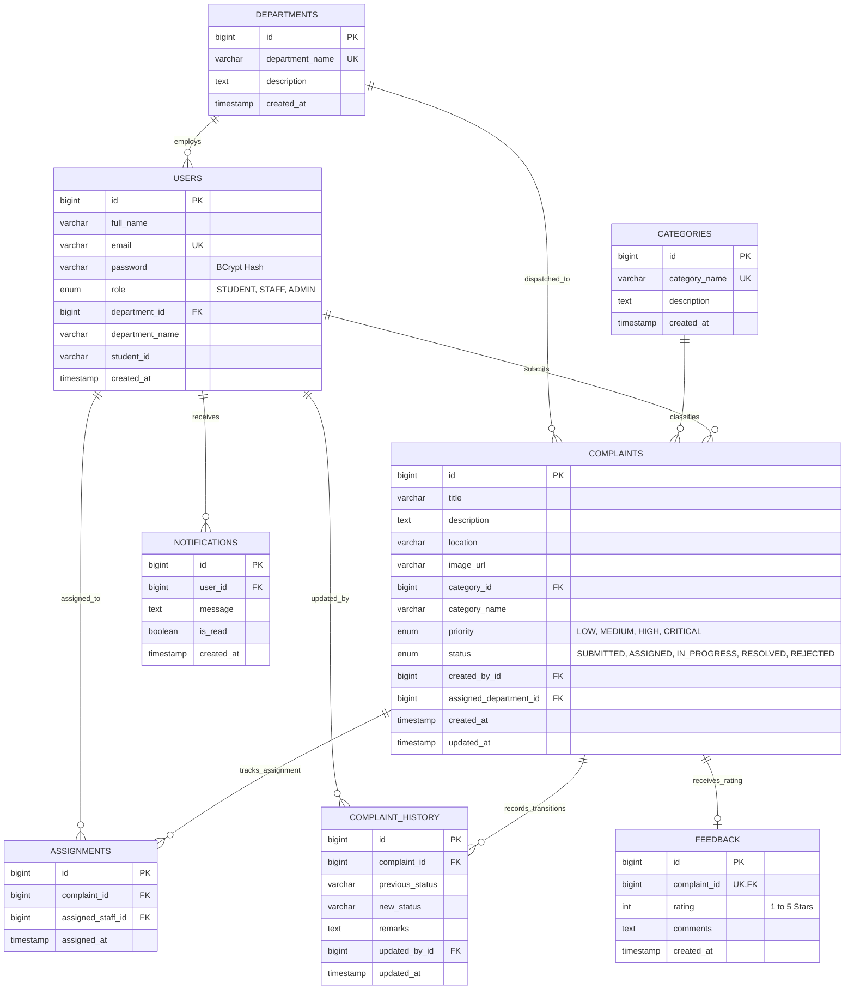

# CampusCare: Database Design & Schema Specification

**Database Engine:** MySQL 8.0 Enterprise  
**Default Collation:** `utf8mb4_unicode_ci`  
**Storage Engine:** InnoDB (ACID Compliant)

---

## 1. Entity-Relationship (ER) Diagram

---

## 2. Table Specifications

### 2.1 `departments`
Stores academic and physical operations departments across the institution.

| Column | Type | Constraints | Description |
|---|---|---|---|
| `id` | `BIGINT` | `PRIMARY KEY, AUTO_INCREMENT` | Unique institutional department identifier |
| `department_name` | `VARCHAR(100)` | `NOT NULL, UNIQUE` | Formal department title (e.g. Facilities, OIT) |
| `description` | `TEXT` | `NULLABLE` | Scope of operational maintenance coverage |
| `created_at` | `TIMESTAMP` | `DEFAULT CURRENT_TIMESTAMP` | Department record creation timestamp |

---

### 2.2 `categories`
Standardized campus service problem classifications utilized by student intake and machine learning models.

| Column | Type | Constraints | Description |
|---|---|---|---|
| `id` | `BIGINT` | `PRIMARY KEY, AUTO_INCREMENT` | Primary key |
| `category_name` | `VARCHAR(100)` | `NOT NULL, UNIQUE` | Name (Electrical, Plumbing, Wi-Fi, Equipment, etc.) |
| `description` | `TEXT` | `NULLABLE` | Technical scope definition |
| `created_at` | `TIMESTAMP` | `DEFAULT CURRENT_TIMESTAMP` | Inception timestamp |

---

### 2.3 `users`
Central institutional identity registry for students, technicians, and administrators.

| Column | Type | Constraints | Description |
|---|---|---|---|
| `id` | `BIGINT` | `PRIMARY KEY, AUTO_INCREMENT` | Internal user ID |
| `full_name` | `VARCHAR(150)` | `NOT NULL` | Formal legal name |
| `email` | `VARCHAR(150)` | `NOT NULL, UNIQUE` | Institutional email (username for authentication) |
| `password` | `VARCHAR(255)` | `NOT NULL` | BCrypt salted cryptographic hash (`$2a$10$...`) |
| `role` | `ENUM` | `NOT NULL` | Permission tier: `'STUDENT'`, `'STAFF'`, `'ADMIN'` |
| `department_id` | `BIGINT` | `NULLABLE, FK -> departments(id)` | Associated department for staff personnel |
| `department_name`| `VARCHAR(150)` | `NULLABLE` | Cached department name for optimized read access |
| `student_id` | `VARCHAR(50)` | `NULLABLE` | University matriculation / student roll number |
| `created_at` | `TIMESTAMP` | `DEFAULT CURRENT_TIMESTAMP` | Account registration timestamp |

**Indexes & Foreign Keys:**
- `INDEX idx_users_email (email)`
- `INDEX idx_users_role (role)`
- `FOREIGN KEY (department_id) REFERENCES departments(id) ON DELETE SET NULL`

---

### 2.4 `complaints`
The primary operational work order entity tracking facility requests from submission to resolution.

| Column | Type | Constraints | Description |
|---|---|---|---|
| `id` | `BIGINT` | `PRIMARY KEY, AUTO_INCREMENT` | Institutional ticket reference number |
| `title` | `VARCHAR(200)` | `NOT NULL` | Brief summary of the service malfunction |
| `description` | `TEXT` | `NOT NULL` | Comprehensive narrative detailing the issue |
| `location` | `VARCHAR(255)` | `NOT NULL` | Specific campus location (Block, Room, Hall) |
| `image_url` | `VARCHAR(500)` | `NULLABLE` | URI path to attached photographic evidence |
| `category_id` | `BIGINT` | `NULLABLE, FK -> categories(id)` | Relational link to standardized category |
| `category_name` | `VARCHAR(100)`| `NULLABLE` | Cached category string |
| `priority` | `ENUM` | `NOT NULL, DEFAULT 'MEDIUM'` | Urgency: `'LOW'`, `'MEDIUM'`, `'HIGH'`, `'CRITICAL'` |
| `status` | `ENUM` | `NOT NULL, DEFAULT 'SUBMITTED'` | State: `'SUBMITTED'`, `'ASSIGNED'`, `'IN_PROGRESS'`, `'RESOLVED'`, `'REJECTED'` |
| `created_by_id` | `BIGINT` | `NOT NULL, FK -> users(id)` | Student requester who logged the issue |
| `assigned_department_id` | `BIGINT` | `NULLABLE, FK -> departments(id)` | Department managing resolution |
| `created_at` | `TIMESTAMP` | `DEFAULT CURRENT_TIMESTAMP` | Initial ticket submission timestamp |
| `updated_at` | `TIMESTAMP` | `ON UPDATE CURRENT_TIMESTAMP` | Last modification timestamp |

**Indexes & Foreign Keys:**
- `INDEX idx_complaints_status (status)`
- `INDEX idx_complaints_priority (priority)`
- `INDEX idx_complaints_created_by (created_by_id)`
- `INDEX idx_complaints_department (assigned_department_id)`
- `FOREIGN KEY (category_id) REFERENCES categories(id) ON DELETE SET NULL`
- `FOREIGN KEY (created_by_id) REFERENCES users(id) ON DELETE CASCADE`
- `FOREIGN KEY (assigned_department_id) REFERENCES departments(id) ON DELETE SET NULL`

---

### 2.5 `assignments`
Maintains technician dispatch assignments.

| Column | Type | Constraints | Description |
|---|---|---|---|
| `id` | `BIGINT` | `PRIMARY KEY, AUTO_INCREMENT` | Assignment record identifier |
| `complaint_id` | `BIGINT` | `NOT NULL, FK -> complaints(id)` | Target ticket reference |
| `assigned_staff_id`| `BIGINT` | `NOT NULL, FK -> users(id)` | Dispatched maintenance technician |
| `assigned_at` | `TIMESTAMP` | `DEFAULT CURRENT_TIMESTAMP` | Dispatch timestamp |

**Foreign Keys:**
- `FOREIGN KEY (complaint_id) REFERENCES complaints(id) ON DELETE CASCADE`
- `FOREIGN KEY (assigned_staff_id) REFERENCES users(id) ON DELETE CASCADE`

---

### 2.6 `complaint_history`
Append-only immutable audit trail recording every state change and technician note.

| Column | Type | Constraints | Description |
|---|---|---|---|
| `id` | `BIGINT` | `PRIMARY KEY, AUTO_INCREMENT` | Audit log entry ID |
| `complaint_id` | `BIGINT` | `NOT NULL, FK -> complaints(id)` | Reference to ticket |
| `previous_status`| `VARCHAR(50)` | `NULLABLE` | State before modification |
| `new_status` | `VARCHAR(50)` | `NOT NULL` | State after modification |
| `remarks` | `TEXT` | `NULLABLE` | Operational reason, technician diagnosis, or notes |
| `updated_by_id`| `BIGINT` | `NULLABLE, FK -> users(id)` | User or technician executing the update |
| `updated_at` | `TIMESTAMP` | `DEFAULT CURRENT_TIMESTAMP` | Transaction timestamp |

---

### 2.7 `feedback`
Post-resolution student satisfaction ratings and quality reviews.

| Column | Type | Constraints | Description |
|---|---|---|---|
| `id` | `BIGINT` | `PRIMARY KEY, AUTO_INCREMENT` | Feedback entry identifier |
| `complaint_id` | `BIGINT` | `NOT NULL, UNIQUE, FK -> complaints(id)` | 1-to-1 link to resolved ticket |
| `rating` | `INT` | `NOT NULL, CHECK (1 <= rating <= 5)`| 1 to 5 star rating score |
| `comments` | `TEXT` | `NULLABLE` | Qualitative feedback remarks |
| `created_at` | `TIMESTAMP` | `DEFAULT CURRENT_TIMESTAMP` | Submission timestamp |

---

### 2.8 `notifications`
User alert inbox for ticket lifecycle events.

| Column | Type | Constraints | Description |
|---|---|---|---|
| `id` | `BIGINT` | `PRIMARY KEY, AUTO_INCREMENT` | Notification identifier |
| `user_id` | `BIGINT` | `NOT NULL, FK -> users(id)` | Recipient user ID |
| `message` | `TEXT` | `NOT NULL` | Notification banner text |
| `is_read` | `BOOLEAN` | `NOT NULL, DEFAULT FALSE` | Read status |
| `created_at` | `TIMESTAMP` | `DEFAULT CURRENT_TIMESTAMP` | Dispatch timestamp |

---

## 3. Database Persistence & Integrity Safeguards

1. **Foreign Key Cascading Rules:**
   - Deleting a complaint automatically cascades to its `assignments`, `complaint_history`, and `feedback` records, preventing dangling references.
   - Deleting a department sets `assigned_department_id` to `NULL` on associated complaints, preserving ticket data.
2. **ACID Transaction Boundaries:**
   - Every status transition executes within a Spring `@Transactional` context ensuring atomicity: if writing to `complaint_history` fails, the complaint status rollbacks immediately.
3. **Optimized Indexes:**
   - Single and composite indexes on `email`, `role`, `status`, `priority`, and `created_by_id` guarantee sub-millisecond query performance on large tables.
