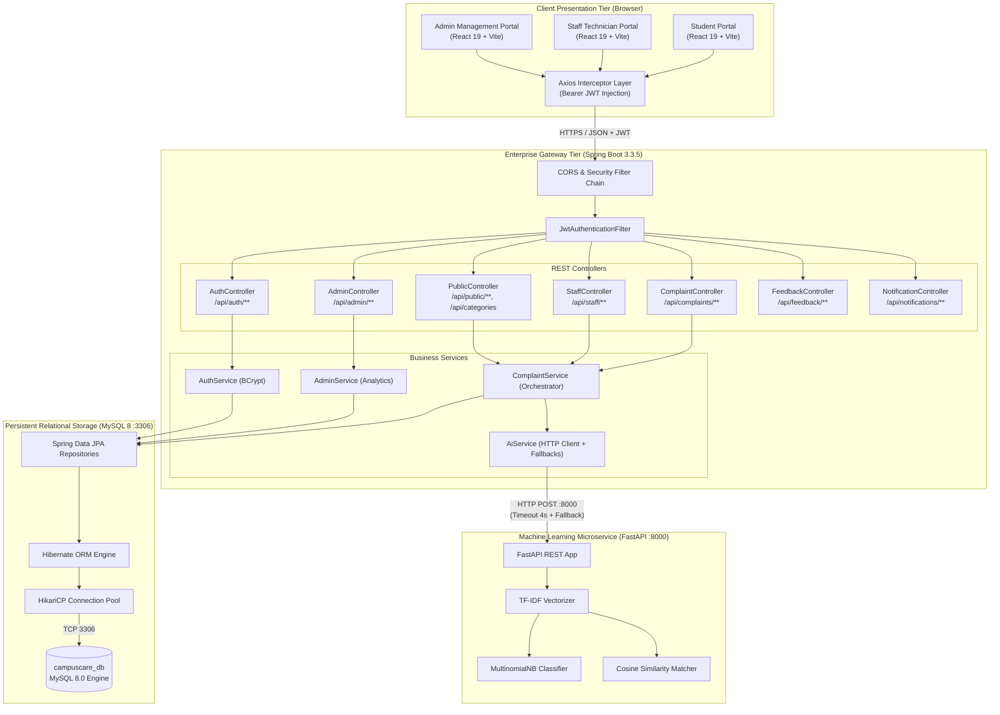
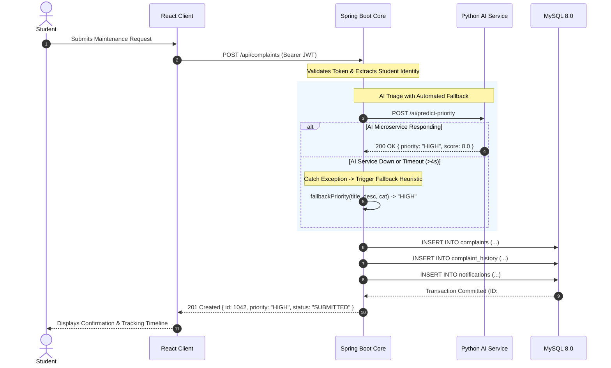

# CampusCare: System Architecture Specification

---

## 1. Architectural Overview

CampusCare employs a decoupled, multi-tier micro-service-oriented architecture designed for high availability, strong type safety, strict separation of concerns, and resilient fault tolerance.

The system is partitioned into four primary layers:
1. **Client Presentation Tier:** React 19 Single Page Application (SPA) styled with Tailwind CSS and bundled via Vite.
2. **Enterprise Application & Security Gateway:** Java 21 / Spring Boot 3.3.5 REST API with Spring Security, JWT stateless session management, and Spring Data JPA.
3. **Machine Learning & Triage Microservice:** Python 3.14 FastAPI service leveraging Scikit-learn NLP models for text classification, priority scoring, and duplicate detection.
4. **Persistent Relational Tier:** MySQL 8.0 Enterprise Relational Database providing ACID-compliant transaction boundaries and referential integrity.

---

## 2. System Architecture Diagram

---

## 3. Component Deep Dive

### 3.1 Frontend Tier (React 19 + Vite + Tailwind CSS)
- **State Management & Routing:** Client-side routing managed by React Router v7. Route protection components (`ProtectedRoute.jsx`) verify active JWT sessions and evaluate user roles (`STUDENT`, `STAFF`, `ADMIN`) before rendering views.
- **HTTP Transport:** Centralized `api.js` Axios instance intercepts all outgoing HTTP requests, automatically injecting the `Authorization: Bearer <token>` header stored in `sessionStorage` or `localStorage`.
- **UI System:** Clean, enterprise SaaS design language utilizing an institutional navy (`#0f1c34`) sidebar, neutral slate backgrounds (`#f8fafc`), clean white card containers, and high-contrast teal (`#0d9488`) interactive highlights.

### 3.2 Enterprise Core (Spring Boot 3.3.5)
- **Security & Authorization:** Spring Security 6 provides stateless authentication. Passwords are encrypted using BCrypt with a default cost factor of 10. Every protected endpoint enforces strict role matching (`hasRole('ADMIN')`, `hasAnyRole('STAFF', 'ADMIN')`, or authenticated ownership).
- **Ownership Verification:** Implemented in `ComplaintService.getComplaintById()`, guaranteeing that students can only inspect their own submitted tickets, preventing cross-student data exposure.
- **Transaction Management:** Multi-table operations (e.g., ticket creation with complaint history logging and staff notifications) execute under `@Transactional` boundaries, ensuring zero orphan records.
- **Graceful AI Degradation:** `AiService.java` manages an asynchronous HTTP client with strict 4-second timeouts. If the Python AI service is unreachable, hardcoded institutional domain heuristics immediately take over triage duties, ensuring zero disruption to campus ticket intake.

### 3.3 Machine Learning Microservice (Python FastAPI)
- **FastAPI Framework:** Asynchronous high-performance Python framework serving model inference via REST endpoints (`/ai/classify`, `/ai/predict-priority`, `/ai/detect-duplicates`).
- **Classification Pipeline:** Built using Scikit-learn's `TfidfVectorizer` paired with a `MultinomialNB` model trained on campus incident lexicons (Electrical, Plumbing, HVAC, Wi-Fi, Classroom Equipment, Safety).
- **Duplicate Detection:** Computes pairwise cosine similarity between newly submitted tickets and unresolved tickets sharing the same campus location and category. Matches exceeding 0.35 similarity are flagged for administrative clustering.

### 3.4 Persistent Database (MySQL 8.0)
- **Database Engine:** MySQL 8.0 InnoDB storage engine providing ACID transactions, foreign key constraints, UTF-8 multibyte encoding (`utf8mb4`), and indexed search on ticket status, category, and timestamps.
- **Connection Pooling:** High-throughput `HikariCP` connection pool configured for optimal concurrent resource allocation.

---

## 4. Inter-Component Communication Protocols

| Source | Destination | Protocol / Format | Authentication | Payload Content |
|---|---|---|---|---|
| **React Client** | **Spring Boot Gateway** | HTTPS / REST / JSON | Bearer JWT (HMAC-SHA256) | User credentials, ticket forms, status transitions, ratings |
| **Spring Boot Gateway** | **FastAPI AI Service** | HTTP / REST / JSON | Internal Network / Localhost | Raw complaint text, category, location, candidate ticket batch |
| **Spring Boot Gateway** | **MySQL 8.0** | JDBC / TCP (Port 3306) | MySQL Native Authentication | Relational CRUD, entity mappings, transactional commits |

---

## 5. Failure Modes & Fault Tolerance

